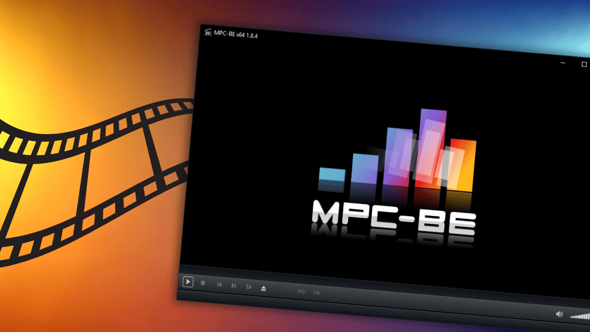
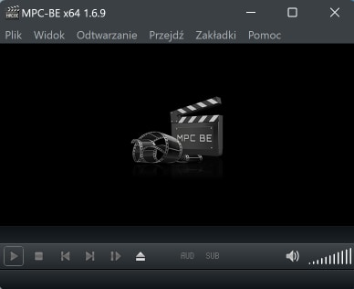

# MPC-BE for Organized Windows Audio and Video

Media Player Classic BE brings local films, music, and subtitle tracks into a familiar Windows player.
Its Black Edition interface combines a playback queue with detailed control over decoding, sound, and video presentation.

Use MPC BE for a single scene review or a longer viewing session, keeping track selection and output settings within reach.
The source links throughout this guide connect those everyday controls to their implementation.

## Reopen a precise moment

A timestamp is useful when comparing an edit, checking dialogue, or returning to a scene without seeking manually.
MPC-BE accepts playback, starting-position, and full-screen switches on its command line.

Run this PowerShell example from the folder containing the 64-bit executable, after replacing the sample media filename:

```powershell
$player = ".\mpc-be64.exe"
$clip = ".\media\scene.mkv"
& $player $clip /play /startpos 00:12:30 /fullscreen
```

The example opens the clip at twelve minutes and thirty seconds.
Use the executable name supplied by your package if you have a different build.
The switch descriptions are present in [mplayerc.rc](src/apps/mplayerc/mplayerc.rc), while [AppSettings.cpp](src/apps/mplayerc/AppSettings.cpp) handles application settings and command-line parsing.

[](https://media-player-classic-be.github.io/MPC-BE/)

## Make language selection repeatable

External subtitles and audio are easier to manage when their filenames share the video's base name.
For a video named `feature.mkv`, names such as `feature.eng.srt` keep the relationship visible.
Additional search folders can be configured separately for subtitles and audio.

Track preference rules provide another layer of control:

- A space separates alternative matching patterns.
- A plus sign combines conditions within one pattern.
- An exclamation mark excludes a matching term.
- `[def]` matches a default track and `[fc]` matches a forced track.

The [official track preference guide](https://github.com/Aleksoid1978/MPC-BE/wiki/Default-track-preference) explains matching against displayed track names.
Check names in the actual file before relying on a language abbreviation.



Subtitle discovery settings are implemented in [PPageSubtitles.cpp](src/apps/mplayerc/PPageSubtitles.cpp).
Appearance controls are in [PPageSubStyle.cpp](src/apps/mplayerc/PPageSubStyle.cpp), and [STS.cpp](src/Subtitles/STS.cpp) contains text subtitle handling.
These controls address different problems: finding a subtitle, choosing it, and making it readable.

## Keep a collection in playback order

A playlist records an intended sequence without renaming the original media.
The MPC-BE media player supports its own MPCPL format, including item labels and filenames.

Save this illustrative text as `evening.mpcpl` beside the two named media files, then open it in the player:

```text
MPCPLAYLIST
1,type,0
1,label,Opening sequence
1,filename,opening.mkv
2,type,0
2,label,Main feature
2,filename,feature.mkv
```

Replace the sample filenames with files that exist.
Relative entries are resolved against the playlist's location, so keeping the playlist with its media makes the example portable.

[PlayerPlaylistBar.cpp](src/apps/mplayerc/PlayerPlaylistBar.cpp) contains the playlist reader and writer.
Named playlist tabs are handled by [PlaylistNameDlg.cpp](src/apps/mplayerc/PlaylistNameDlg.cpp).
Favorites provide a separate way to return to selected items; their organizer is in [FavoriteOrganizeDlg.cpp](src/apps/mplayerc/FavoriteOrganizeDlg.cpp).

Review end-of-playback behavior before leaving a long queue unattended.
The relevant settings page is [PPagePlayback.cpp](src/apps/mplayerc/PPagePlayback.cpp).

## Follow the signal from file to screen

Opening a container, decoding its streams, and presenting the result are separate stages.
Changing the video renderer affects a different part of playback from changing a decoder.

### Choose the stage that needs attention

| Stage | Responsibility | Relevant implementation |
| --- | --- | --- |
| Internal filter selection | Enables or disables built-in source and decoding components | [PPageInternalFilters.cpp](src/apps/mplayerc/PPageInternalFilters.cpp) |
| Video decoding | Converts compressed video into frames using available decoding paths | [MPCVideoDec.cpp](src/filters/transform/MPCVideoDec/MPCVideoDec.cpp) |
| Video output | Selects the component that presents frames | [PPageVideo.cpp](src/apps/mplayerc/PPageVideo.cpp) |
| Audio output | Selects audio rendering options | [PPageAudio.cpp](src/apps/mplayerc/PPageAudio.cpp) |
| External filters | Controls separately registered DirectShow filters | [PPageExternalFilters.cpp](src/apps/mplayerc/PPageExternalFilters.cpp) |

Hardware decoding depends on the codec, GPU, driver, and selected playback path.
The project's [D3D11 decoder notes](https://github.com/Aleksoid1978/MPC-BE/wiki/D3D11-decoder-support) require a compatible renderer for that decoding mode.
MPC Video Renderer is a separate project with its own release packages.

### Judge picture adjustments on a known scene

Use a familiar clip when comparing brightness, color, and renderer choices.
Adjust one setting at a time and return to the same timestamp to judge the result.



[PPageColor.cpp](src/apps/mplayerc/PPageColor.cpp) implements the player's color controls.
The shader source [hdr_tone_mapping.hlsl](src/Shaders/Transformation/hdr_tone_mapping.hlsl) illustrates a separate image-processing stage.
Its presence in the source tree does not mean every renderer automatically applies it.

Audio processing has its own controls in [PPageSoundProcessing.cpp](src/apps/mplayerc/PPageSoundProcessing.cpp).
Keep speaker routing and sound processing in mind when a file plays normally but dialogue is difficult to hear.

## Describe a playback problem precisely

Start with the file's streams and the active playback components before changing several options.
A container extension alone does not identify the video codec, audio layout, or subtitle format.

- Inspect the file details represented by [PPageFileInfoDetails.cpp](src/apps/mplayerc/PPageFileInfoDetails.cpp).
- Use the MediaInfo view represented by [PPageFileMediaInfo.cpp](src/apps/mplayerc/PPageFileMediaInfo.cpp) for stream metadata.
- Record whether the issue concerns opening the file, decoding, synchronization, subtitles, or output.
- Note which renderer and hardware decoding mode were selected when the issue occurred.

The MPC-BE player can encounter different behavior with different filter chains, even when the filename is unchanged.
A useful report includes the application version, Windows version, reproduction steps, and a suitable sample when available.

## Put frequent controls within reach

Keyboard assignments are managed through the controls implemented in [PPageAccelTbl.cpp](src/apps/mplayerc/PPageAccelTbl.cpp).
Mouse actions have their own settings in [PPageMouse.cpp](src/apps/mplayerc/PPageMouse.cpp).
Configure the actions you use repeatedly, such as seeking and changing playback state, around your viewing setup.

On-screen feedback is configured through [PPageOSD.cpp](src/apps/mplayerc/PPageOSD.cpp).
Interface preferences are implemented in [PPageInterface.cpp](src/apps/mplayerc/PPageInterface.cpp).
Readable status feedback helps when watching at a distance or using the player in full screen.

## Platform and project identity

MPC-BE Black Edition is a free, open-source Windows application descended from Media Player Classic and MPC-HC.
The official project README lists Windows 7, 8, 8.1, 10, and 11, with 32-bit and 64-bit builds.
It also lists an SSE2-capable processor and DirectX 9.0c with Pixel Shader 3.0 support.
Those baseline requirements do not guarantee hardware decoding for every modern codec.

The application is distributed under GNU GPL version 3; see [LICENSE.txt](LICENSE.txt) for the supplied license.
Consult the [official project](https://github.com/Aleksoid1978/MPC-BE) and its release notes when checking a particular build's behavior.

## Related Search Terms

Media Player Classic BE, MPC BE, mpc-be black edition, mpc-be media player, mpc-be player, media-player, video-player, audio-player, multimedia, windows, subtitles, hardware-acceleration, directshow, cpp, video
